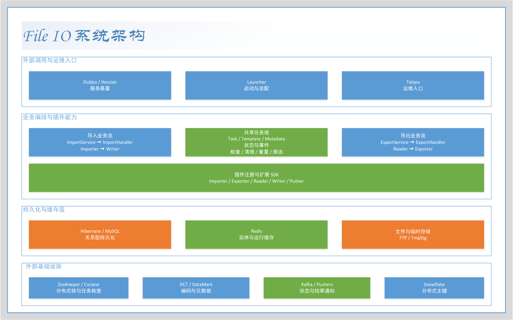
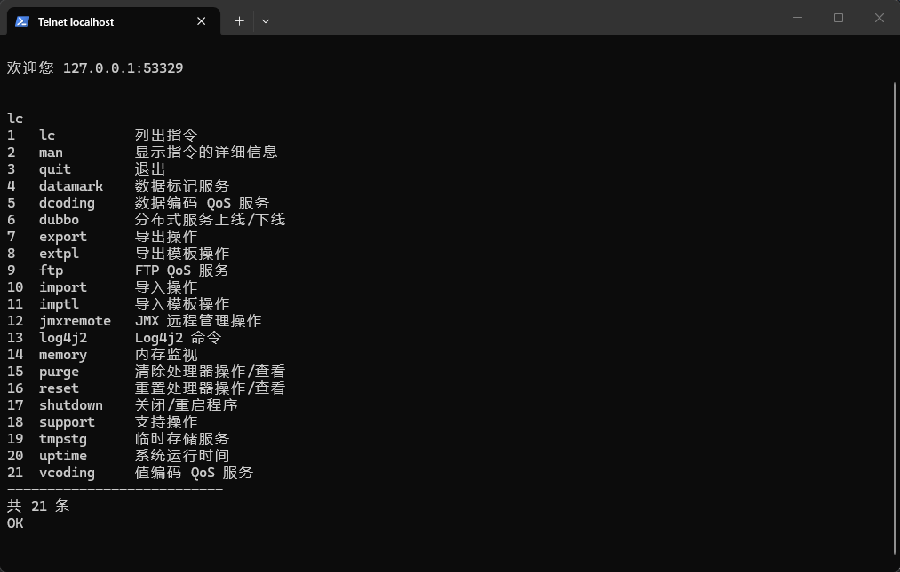

# File IO Introduction - File IO 简介

File IO 是一款开箱即用的模板化文件导入导出系统， 用于根据预先定义的任务设置、模板和元数据执行数据导入、数据导出与结果文件管理。

在业务系统中，批量文件处理通常既需要确定的数据来源与输出格式，也需要保存执行过程、文件内容和处理结果。例如：

- 按照固定模板导入业务数据，并将处理结果写入指定目标。
- 从数据库或其它数据源读取数据，生成 CSV、DCT 或 Excel 等格式的文件。
- 为不同用户维护可复用的导入导出模板，并通过异步任务执行耗时的数据处理。

上述场景可以抽象为以下过程：

```text
配置任务设置 -> 创建任务 -> 上传文件或读取数据 -> 导入/导出处理 -> 保存结果 -> 查询或下载文件
```

File IO 将模板、任务、文件、元数据、读取器、写入器、导入器和导出器拆分为独立机制， 并维护任务创建、执行、状态流转、结果保存和后续清理的标准调用流程。

导入任务负责接收上传文件或文件流，并将其交由导入器解析后写入目标； 导出任务负责通过读取器取得源数据，交由导出器生成文件后供调用方下载。
任务可以同步执行，也可以异步执行；任务状态覆盖创建、进行、完成、失败、过期和死亡等阶段。

---

## 国际化（I18N）

您正在阅读的文档是中文文档，您可以在 [wiki](./docs/wiki) 目录下找到其他语言的文档。

You are reading the Chinese document. You can find documents in other languages in the [wiki](./docs/wiki) directory.

- [简体中文](./docs/wiki/zh-CN/Introduction.md)
- [English](./docs/wiki/en-US/Introduction.md)

## 特性

- 以导入任务设置与导出任务设置为核心，支持模板和任务元数据的独立维护与复用。
- 导入服务支持创建任务、上传文件或文件流、同步执行或异步执行，以及下载已保存的任务文件。
- 导出服务支持创建任务、维护任务元数据、同步执行或异步执行，以及下载导出的文件或文件流。
- 导入任务和导出任务统一记录执行时长、处理数据量、消息和过期/死亡时间，并提供创建、进行、完成、失败、过期和死亡状态。
- 内置 CSV、DCT、Excel 和日志导出器，DCT 导入器，以及过滤、JDBC、Mock、SELS、SPLS 读取器和日志写入器。
- 提供导入器、导出器、读取器、写入器和推送器的 SDK 扩展接口，可接入自定义文件格式与数据源、数据目标。
- 提供任务检查、重置、清理、支持项重置和推送机制，用于维护异常任务、周期性处理和终态事件通知。
- 完整节点集成 Hibernate、Redis、Dubbo、Curator、FTP、临时存储、DataMark 和 DCT 相关组件， 并提供基于 Telnet 的 Telqos 运维指令。

## 系统架构

File IO 的系统架构图如下：



调用方通过导入或导出服务创建任务，并按任务类型上传输入文件、维护任务元数据或提供数据源配置。
执行过程中，导入器与导出器分别协调读取、解析、写入和结果文件保存； 任务检查服务处理超时任务，重置、清理和推送机制负责运行期维护与通知。

## 运行环境

### 核心环境

- Java 8。
- 关系型数据库；`fileio-node-all-he` 默认使用 MySQL 与 Hibernate。
- Redis，用于实体缓存和运行数据缓存。
- ZooKeeper 与 Curator，用于任务检查和清理等服务的分布式锁。
- Dubbo 与 Snowflake 分布式服务，用于服务暴露、调用和分布式主键生成。

### 集成环境

- FTP 与临时存储，用于文件与临时内容处理。
- DataMark 与 DCT 服务，用于节点中已装配的相关文件处理能力。
- Kafka；使用原生 Kafka 推送器时需要。

## 文档

该项目的文档位于 [docs](./docs) 目录下，包括：

### wiki

wiki 为项目开发人员和使用者编写的详细文档，包含不同语言的版本，主要入口为：

1. [简介](./docs/wiki/zh-CN/Introduction.md) - 镜像的 `README.md`，与本文件内容基本相同。
2. [目录](./docs/wiki/zh-CN/Contents.md) - 文档目录。

## 运行截图

Telnet 运维平台指令合集：


